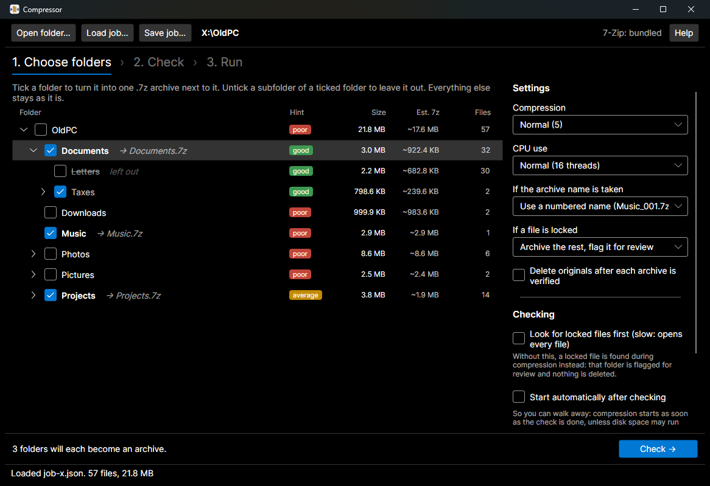
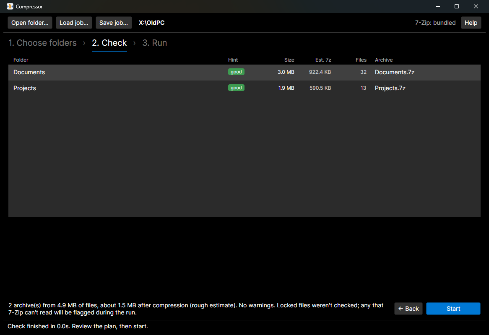
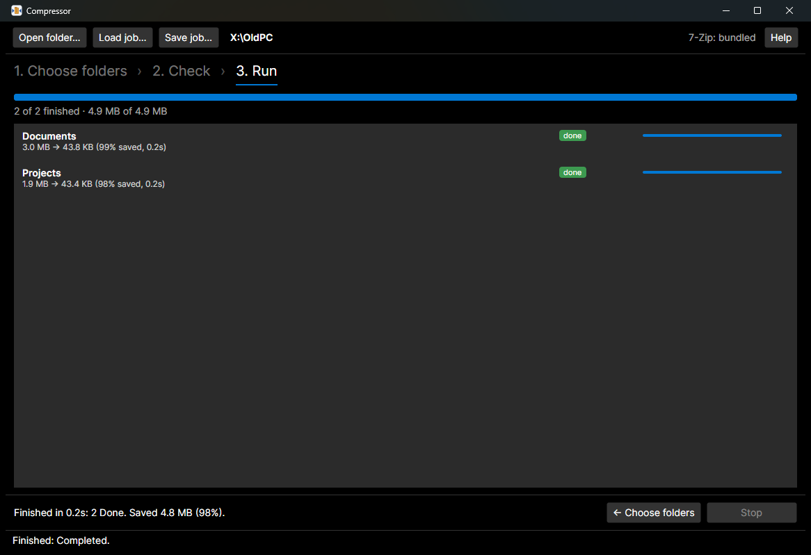

<p align="center"></p>

<h1 align="center">Compressor</h1>

<p align="center">
Compress the folders you choose into <code>.7z</code> archives, right where they are,<br>
and keep the rest of the folder tree browsable and searchable.
</p>

<p align="center"></p>

## Why

Archiving an old drive or a former PC's user folder usually means one of two things:

- **One big archive.** Compact, but its contents vanish from Windows Search and from tools like [Everything](https://www.voidtools.com/): you can no longer find a file by name without opening the archive first.
- **Nothing at all.** Everything stays searchable, but gigabytes of old documents, logs, exports and source trees stay uncompressed.

Compressor sits in between. You keep the folder tree and decide, folder by folder, what becomes an archive: `Documents\Taxes` turns into `Documents\Taxes.7z`, while `Photos` (already compressed, nothing to gain) stays as it is. Everything you didn't tick keeps its names on disk, so search tools keep finding it.

## Features

- **Folder tree with sizes and hints.** One quick pass over the tree shows every folder's size, file count, estimated archive size, and a *good / average / poor* hint, so it's obvious where compression pays off (text, documents, databases) and where it doesn't (photos, video, existing archives).
- **Tick what to compress.** A ticked folder becomes one `.7z` next to it; untick a subfolder to leave it out of its parent's archive. Folders and files you don't tick are never touched.
- **Check before anything is written.** Planned archives, estimated savings, and warnings (names already taken, unreadable folders, low disk space, leftovers from an interrupted run, and optionally locked files), with a progress bar and Cancel.
- **Every archive is verified.** 7-Zip re-reads it and checks every CRC, and the archive must contain exactly the files that went in, with the same sizes.
- **Optional: delete the originals** after verification, under strict rules (only files that are unchanged since they were archived).
- **Unattended runs.** "Start automatically after checking" lets a long job run while you're away; several folders compress in parallel.
- **Job files.** Save your selection and settings as JSON, load them later, or run them from the command line.
- **Command-line tool** (`compressor`) for scanning, planning and running jobs from scripts.
- **Self-updating** through [app-update-server](https://github.com/mcanyucel/app-update-server), and a per-user installer that needs no admin rights.
- Uses the real [7-Zip](https://www.7-zip.org) (bundled, unmodified, checked against its SHA-256 at startup) for fast, multi-threaded LZMA2.

## How it works

Say an old PC's folder looks like this, and you tick `Documents`, `Music` and `Projects`, then untick `Documents\Letters` and `Projects\website\bin`:

```
OldPC\                                    OldPC\
├── Documents\              ✔             ├── Documents.7z        ← everything in Documents except Letters
│   ├── Letters\            ✘ (left out)  ├── Documents\
│   └── Taxes\                            │   └── Letters\        ← left as it was
├── Music\                  ✔      ──►    ├── Music.7z
├── Photos\                               ├── Photos\             ← not ticked: untouched
└── Projects\               ✔             ├── Projects.7z         ← everything except website\bin
    └── website\bin\        ✘ (left out)  └── Projects\website\bin\
```

The right side is the result **with "Delete originals" switched on**. Without it, the originals stay and the archives simply appear next to them.

The rule behind the checkboxes: **the nearest tick (or untick) above a file wins.** A ticked folder becomes an archive; its subfolders are included unless you untick them; ticking a folder inside an unticked one makes it its own archive again.

Each archive holds its folder's *contents* (`Documents.7z` contains `Taxes\...`, not `Documents\Taxes\...`), so 7-Zip's *Extract to "Documents\\"* restores the folder exactly.

## Install

Compressor runs on **Windows 10 and 11 (64-bit)**.

1. Download `Compressor-<version>-setup.exe` from the [latest release](https://github.com/mcanyucel/compressor/releases/latest).
2. Run it. It installs for your user account only (into `%LocalAppData%\Programs\Compressor`), without asking for admin rights, and includes everything it needs: the .NET runtime and 7-Zip.

The installer is **not code-signed**, so Windows SmartScreen may say *"Windows protected your PC"* the first time. Choose **More info ▸ Run anyway**. Updates installed from inside the app don't trigger this.

Options during setup: a desktop icon, and adding the command-line tool to your PATH. Uninstall from *Settings ▸ Apps*; your settings in `%AppData%\Compressor` are kept.

**Updates:** Compressor checks for a new version when it starts (you can turn that off in *Help ▸ About*), and *Help ▸ Check for updates* checks on demand. An update closes the app, installs, and opens it again. It is never installed while a job is running.

## Using the app

### 1. Choose folders

*Open folder…* the folder you want to archive (or *Load job…* a saved job). The tree fills in as soon as a quick scan has counted the files.

- **Tick** a folder to turn it into an archive. It turns bold and shows its archive name, e.g. `→ Documents.7z`. Its subfolders show as included.
- **Untick** a subfolder of a ticked folder to leave it out (struck through, *left out*).
- The **Hint** column shows how worthwhile compression is: *good* (mostly text, documents, databases, uncompressed images), *poor* (mostly photos, video, music, existing archives), *average* (mixed or unknown). It is weighted by bytes, so one big video outweighs a hundred small text files. *Est. 7z* is a rough estimate.

| Setting | What it does |
|---|---|
| **Compression** | 7-Zip level: Fastest (1) … Ultra (9). Normal (5) is a good balance; Ultra is slow and memory-hungry on old hardware. |
| **CPU use** | How many threads to use in total, from Minimum to Maximum. Several folders compress at the same time. |
| **If the archive name is taken** | Use a numbered name (`Music_001.7z`), or skip that folder. Existing files are never overwritten. |
| **If a file is locked** | *Archive the rest, flag it for review* (the archive is kept as `.7z.tmp` for you to look at), or *Don't archive that folder*. |
| **Delete originals after each archive is verified** | See [What gets deleted](#what-gets-deleted). Off by default. |
| **Look for locked files first** | Opens every file during the check to find ones 7-Zip can't read. Slow on large trees (your antivirus scans each file on its first open); without it, locked files are still caught safely during the run. |
| **Start automatically after checking** | The button becomes *Check and start*: compression begins as soon as the check is done, so you can walk away. It stops at the check only if disk space may run out. |

*Save job…* keeps the selection and settings as a JSON file for later, or for the command line.

### 2. Check



*Check* builds the plan without writing anything: one row per archive with its size, estimate and name, and warnings grouped by kind (rules that point nowhere, archive names already taken, unreadable folders, links and junctions that are skipped, leftovers from an interrupted run, low disk space, and locked files if you asked for that check). A progress bar shows how far it has got; *Cancel* goes back.

What runs is always exactly what was checked: changing any tick or setting afterwards means checking again.

### 3. Run



*Start* compresses, then verifies each archive. Each folder ends in one of these states:

| State | Meaning |
|---|---|
| **done** | Archived and verified (and the originals deleted, if you chose that). |
| **needs attention** | Something to review, nothing lost: a locked file was left out (the archive is kept as `.7z.tmp`), verification failed (the archive is kept as `.7z`), or some originals were kept because they changed. The details are shown under the folder. |
| **failed** | No archive was made (e.g. 7-Zip error, unreadable folder). Nothing was deleted. |
| **skipped** | The folder had no files to compress. |
| **cancelled** | You pressed *Stop* (or closed the app). Unfinished archives are removed. |

## What gets deleted

Only with **Delete originals** switched on, only after the folder's archive has passed verification, and only:

- **files that went into the archive**, and only if their size and modification time are still the same as when they were archived. Anything changed is kept, and the folder is flagged for review;
- **folders that those deletions left empty.** A folder that was already empty, or still holds anything at all (a hidden file, an excluded subfolder, a link), stays.

Files you excluded, lock files, links and junctions, and anything added since the archive was made are never touched. Read-only files are deleted (they're safely in the archive).

## What Compressor never does

- Overwrite or append to an existing archive. A taken name gets a numbered one, or the folder is skipped.
- Follow symbolic links or junctions. Old Windows profiles are full of junctions such as `Application Data` that would otherwise be archived twice or loop forever; they're listed as skipped.
- Touch a leftover `.7z.tmp` from an interrupted run. It's reported, and you decide.
- Delete anything that isn't verified to be in an archive.
- Archive Office lock files and temporary files (`~$*`, `*.tmp`, `*.lck`, `*.lock`). Hidden and system files *are* archived.

## Command line

The installer can put `compressor.exe` on your PATH. It works on the same job files as the app.

```
compressor scan <folder> [--depth N] [--write <job.json>]
compressor plan <job.json>
compressor run  <job.json> [--yes]
compressor version
```

| Command | |
|---|---|
| `scan` | Size, file count, estimated archive size and hint per subfolder (`--depth`, default 1). `--write` creates a starter job file that ticks the top-level folders rated good or average; review it before running. |
| `plan` | Builds the job and runs every check, including the locked-file check. Changes nothing on disk. |
| `run` | The same, then asks for confirmation (`--yes` skips it), compresses and verifies, with live progress. Ctrl+C stops cleanly. |
| `version` | Prints the version. |

`--7zip <path>` uses a specific 7-Zip executable instead of the bundled one.

Exit codes: `0` everything done · `1` finished, but some folders need attention, failed or were cancelled · `2` bad arguments, unreadable job file, or 7-Zip not found · `3` stopped (Ctrl+C) or not confirmed.

```powershell
compressor scan "D:\OldPC" --depth 2 --write job.json
notepad job.json
compressor plan job.json
compressor run job.json
```

### Job files

```jsonc
{
  // Comments and trailing commas are allowed.
  "rootPath": "D:\\OldPC",
  "parallelism": "Normal",            // Minimum, Low, Normal, High, Maximum
  "compressionLevel": 5,              // 0 (store) to 9 (ultra)
  "collisionBehavior": "RenameNew",   // RenameNew or Skip
  "lockedFileBehavior": "Skip",       // Skip (archive the rest) or AbortSubJob (no archive)
  "deleteAfterVerify": false,
  "rules": [
    { "relativePath": "Documents",           "action": "Compress" },
    { "relativePath": "Documents/Letters",   "action": "Skip" },
    { "relativePath": "Notes/todo-2009.txt", "action": "Compress" }
  ]
}
```

`rootPath` must be absolute; rule paths are relative to it and may use `/` or `\`. A `Compress` rule on a file makes an archive of just that file (`todo-2009.txt.7z`).

## Building from source

**Prerequisites:** [.NET 10 SDK](https://dotnet.microsoft.com/download) and [PowerShell 7](https://learn.microsoft.com/powershell/scripting/install/installing-powershell). For the installer also [Inno Setup 6](https://jrsoftware.org/isinfo.php) and Python 3; for the icon, [Inkscape](https://inkscape.org).

```powershell
git clone https://github.com/mcanyucel/compressor
cd compressor
pwsh third-party/7zip/fetch.ps1        # once: downloads and verifies the bundled 7-Zip (not stored in git)
dotnet build
dotnet test Tests                      # 7-Zip tests skip themselves if no 7-Zip is found
dotnet run --project Ui                # the app (optionally: -- "D:\OldPC" or -- job.json)
dotnet run --project Cli -- scan "D:\OldPC"
```

Without the fetched 7-Zip the build warns and the app uses an installed 7-Zip instead. See [third-party/7zip/README.md](third-party/7zip/README.md) for how the bundle is pinned and upgraded.

### Installer and releases

```powershell
pwsh installer/build.ps1               # tests, self-contained publish, checks, artifacts\Compressor-<version>-setup.exe
pwsh installer/build.ps1 -AllowDirty -SkipTests   # quick test build from uncommitted changes
```

To release:

1. Raise `<Version>` in [Directory.Build.props](Directory.Build.props) and commit.
2. `pwsh installer/build.ps1`. It refuses uncommitted changes, runs the tests, and checks that the third-party notices are up to date.
3. Upload the installer to the update server, so installed copies offer it at their next start:
   ```powershell
   $env:AUS_API_KEY = '...'               # the server's API key; it never goes into the app
   pwsh installer/upload.ps1 -Notes "What changed."
   ```
4. Attach the installer to a GitHub release for new users.

After adding or upgrading a package, a new .NET SDK or a new 7-Zip, regenerate the notices with `python -I installer/make-notices.py` and commit `THIRD-PARTY-NOTICES.txt`. After changing the icon's SVGs, `python -I tools/icon/make-icon.py`.

### Project layout

| Folder | |
|---|---|
| [`Core/`](Core) | The engine, with no UI: job builder (rules ➝ archives), file listing, pre-flight checks, 7-Zip wrapper, compression, verification, deleting originals, and the parallel executor. |
| [`Ui/`](Ui) | The Avalonia desktop app (`CompressorGui.exe`). |
| [`Cli/`](Cli) | The command-line tool (`compressor.exe`). |
| [`Tests/`](Tests) | xUnit tests, including integration tests against real 7-Zip. |
| [`installer/`](installer) | Inno Setup script, build, upload and notices scripts. |
| [`third-party/7zip/`](third-party/7zip) | The pinned 7-Zip release: fetch script, checksums, license. |
| [`tools/icon/`](tools/icon) | The icon's SVG sources. |

The [design document](conceptual-design.md) explains the decisions behind all of this: the rules, the safety checks, the measurements, and what's planned next.

## License

Compressor is released under the [MIT License](LICENSE).

It bundles [7-Zip](https://www.7-zip.org) by Igor Pavlov, unmodified, under the GNU LGPL (some parts BSD 3-clause), and uses Avalonia, SkiaSharp, CommunityToolkit.Mvvm and other open-source components. Their licenses are in [THIRD-PARTY-NOTICES.txt](THIRD-PARTY-NOTICES.txt), which also ships with the app (*Help ▸ About ▸ Third-party licenses*).
